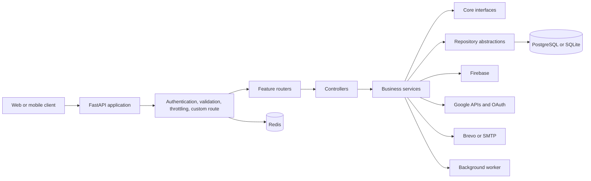

# CU Portal Backend

CU Portal Backend is an asynchronous, modular API for a university student portal. It exposes authenticated user workflows, administrator workflows, public integrations, academic data, announcements, calendar and event management, tasks, notes, materials, messaging, notifications, releases, file operations, and system services.

The project is designed around Clean Architecture ideas: HTTP concerns stay in the API layer, business rules live in services, domain contracts live in `core`, and database/cloud integrations live in infrastructure. The application is composed through dependency injection rather than having controllers construct their own dependencies.

> This README documents the implementation currently present in the repository. It intentionally does not claim that automated tests exist or that every deployment concern is production-ready.

## Architecture At A Glance



### Layer responsibilities

| Layer          | Location             | Responsibility                                                                                 |
| -------------- | -------------------- | ---------------------------------------------------------------------------------------------- |
| API            | `src/api`            | FastAPI routes, controllers, middleware, request composition, and dependency injection         |
| Business       | `src/business`       | Use-case orchestration, business rules, context variables, and application logging             |
| Core           | `src/core`           | DTOs, entities, ORM models, interfaces, validators, response contracts, and reusable utilities |
| Infrastructure | `src/infrastructure` | SQLAlchemy repositories, Alembic migrations, and database stored procedures                    |

The dependency direction is deliberately inward:

```text
HTTP -> routes -> controllers -> services -> interfaces
                                      |
                                      +--> repository contracts
                                      +--> domain entities and DTOs

Infrastructure implements the persistence side of those contracts.
```

## Repository Structure

```text
.
├── src/
│   ├── app.py                         # Composition root and FastAPI application
│   ├── api/
│   │   ├── controllers/               # Thin HTTP-facing adapters
│   │   ├── di/container.py             # Dependency-injector composition root
│   │   ├── middlewares/                # Auth, validation, and request limiting
│   │   └── routes/                     # Feature and access-scope routers
│   ├── business/
│   │   ├── contextVars/                # Request, session, user, and permission scope
│   │   ├── loggers/                    # Application logging implementation
│   │   └── services/                   # Feature use cases and business rules
│   ├── core/
│   │   ├── dtos/                       # Pydantic request, response, and query models
│   │   ├── entities/                   # SQLAlchemy domain entities
│   │   ├── iControllers/               # Controller contracts
│   │   ├── iLoggers/                   # Logger contracts
│   │   ├── iMiddlewares/               # Middleware contracts
│   │   ├── iRepositories/              # Repository contracts
│   │   ├── iServices/                  # Service contracts
│   │   ├── models/                     # Shared model types and query structures
│   │   └── utils/                      # Mapping, caching, auth, response, and validation
│   └── infrastructure/
│       ├── alembic/                    # Versioned schema migrations
│       ├── repositories/               # Generic async repository implementation
│       └── storedProcedures/           # Database-side procedures
├── requirements.txt
├── alembic.ini
├── vercel.json
└── .env.example
```

## Request Lifecycle

1. `src/app.py` loads environment variables and creates the FastAPI application.
2. DTO model references are rebuilt so nested Pydantic response models resolve correctly.
3. Firebase is initialized during the application lifespan startup.
4. The `Container` builds the async SQLAlchemy engine, session factory, repositories, services, controllers, middleware, and routers.
5. `CustomRoute` wraps every route with shared behavior such as cache preparation, active-user enforcement, cache lookup, timeout enforcement, and duplicate-mutation protection.
6. Authentication resolves the token cookie, checks the Redis authentication cache, and falls back to database validation when necessary.
7. Routes validate request DTOs and apply access rules such as readiness, registered subjects, permissions, and administrator scope.
8. Controllers translate DTOs to entities, call services, commit or roll back mutations, and return the standard response envelope.
9. Services apply feature-specific rules and use repositories for persistence.
10. The request middleware closes or rolls back the request session and attaches CORS headers before returning the response.

## Clean Architecture And SOLID

### Single Responsibility Principle

- Routes declare HTTP contracts and dependencies.
- Controllers adapt HTTP input/output and coordinate a use case.
- Services own business rules and feature orchestration.
- Repositories own persistence operations.
- DTOs own validation and serialization boundaries.
- Utilities such as `CachingHandler`, `DatabaseHandler`, and `ResponseHandler` isolate cross-cutting infrastructure concerns.

### Open/Closed Principle

Feature modules follow a repeatable route-controller-service-repository pattern. New domains can be added by introducing feature-specific contracts and implementations while reusing generic CRUD, response, mapping, caching, and DI infrastructure.

### Liskov Substitution Principle

Services, controllers, loggers, and middleware are expressed through interfaces under `src/core/i*`. Implementations can be supplied through the container without changing callers that depend on the contracts.

### Interface Segregation Principle

The project separates service, controller, repository, logger, validation, and request-limit interfaces instead of forcing every component to depend on one large application interface. Feature interfaces specialize generic contracts where a domain needs additional operations.

### Dependency Inversion Principle

Controllers depend on service contracts, services depend on repository contracts, and the composition root selects concrete implementations. `dependency-injector` centralizes construction in `src/api/di/container.py`, keeping object creation out of business code.

### Patterns used

- Clean Architecture / layered architecture
- Dependency injection and composition root
- Repository pattern
- Generic CRUD service and controller contracts
- Unit-of-work style request transaction handling
- DTO/entity mapping
- Middleware and decorator-style route composition
- Cache-aside reads with mutation invalidation
- Distributed Redis locks for duplicate in-flight mutations
- Optimistic versioning on entities that require it
- Database migrations through Alembic

## API Surface

The API is organized by feature and access scope rather than by one monolithic router:

- Authentication and account management
- User and administrator management
- Roles and permissions
- Faculties, departments, years, weeks, and subjects
- Materials and attachments
- Announcements
- Calendar and events
- Exams, tasks, notes, and user completion
- Messages and notifications
- Event organizers
- Releases and release items
- Files and external-drive operations
- Logs and system endpoints

Routes use explicit user, administrator, and public routers. FastAPI generates documentation from route summaries, tags, request DTOs, and response models:

```text
GET /docs
GET /redoc
GET /openapi.json
```

The common response contract is shaped like this:

```json
{
    "success": true,
    "message": null,
    "data": {},
    "next_page": false
}
```

List endpoints can return `next_page` by fetching one record beyond the requested page size. Search models support URL-encoded JSON query parameters for filters, includes, selected fields, ordering, exact matching, and pagination.

## Authentication And Authorization

The authentication middleware provides more than a simple login check:

- Primary authentication uses the `token` cookie.
- Selected flows can resolve a temporary query-string token through Redis.
- Authentication data is cached under a system-scoped Redis key.
- Cache misses validate refresh tokens against persistence.
- User, permission, and registered-subject context is populated with `ContextVar` values.
- Permission checks use the authenticated user's permissions.
- Readiness and active-account checks are enforced at route boundaries.
- Registered-subject restrictions can be included in access and cache-key decisions.
- Successful requests can refresh the authorization cache.
- User activity is tracked through the log repository.

The custom route layer rejects inactive users by default. Routes that intentionally permit inactive accounts can opt out with the `allow_inactive()` route marker.

API-key validation is available for integration endpoints through the `X-API-Key` header and the `API_KEY` environment variable.

## Caching, Concurrency, And Performance

Redis is used as a shared asynchronous coordination layer, not only as a response cache.

### Response caching

- Successful GET JSON responses are cached with a configurable TTL.
- Cache keys include the route, query string, token, registered subjects, and relevant faculty, department, year, and restriction dimensions.
- User and administrator cache keys are separated.
- A cache hit returns the stored JSON response before the controller executes.
- Reads refresh the TTL only while the key still contains the value that was read, avoiding accidental resurrection after concurrent invalidation.

### Invalidation

- Successful POST, PATCH, PUT, and DELETE operations invalidate the affected feature module.
- Related modules such as calendar, materials, tasks, exams, announcements, and weeks can also be invalidated when their source data changes.
- Logout invalidates the relevant user cache.

### Duplicate mutation protection

Mutating requests generate a canonical key from the HTTP method, path, and normalized request body. Redis `SET NX EX` locks prevent identical mutations from executing concurrently and return a conflict response when another copy is already in progress.

### Request controls

- Route-level timeouts default to `DEFAULT_TIMEOUT_SECONDS` and return HTTP 504 when exceeded.
- IP-based request limiting uses a Redis-backed one-minute threshold.
- Selected file, attachment, and external-drive operations can redirect to a background worker.
- Database sessions are request-scoped through `ContextVar` state and are rolled back and closed in the application middleware.

## Persistence

The persistence stack is asynchronous:

- SQLAlchemy 2 async engine and `AsyncSession`.
- `asyncpg` for PostgreSQL and `aiosqlite` for local SQLite fallback.
- Generic `BaseRepository` operations for find, count, distinct queries, create, update, delete, raw SQL, and stored functions.
- Request sessions are reused for transaction consistency.
- Temporary sessions can be created for isolated reads.
- PostgreSQL transaction-pooler mode disables prepared statements and uses `NullPool`, which is appropriate for Supabase-style port `6543` connections.
- Direct/session-mode deployments can use a bounded SQLAlchemy pool with pre-ping, recycling, and configurable statement caches.

### Migrations

Alembic migrations live under `src/infrastructure/alembic/versions`. The history includes the initial PostgreSQL schema plus subsequent changes for authentication, attachments, announcements, notifications, devices, releases, weeks, indexes, optimistic locking, and user completion.

## External Integrations

- Firebase Admin SDK for Firebase services and notifications.
- Google OAuth and Google token flows.
- Google Drive-related file operations.
- Redis or Upstash Redis for caching, authorization state, throttling, and locks.
- PostgreSQL/Supabase for hosted persistence.
- Brevo HTTP email API and optional SMTP delivery.
- Optional background worker for long-running or external-drive operations.

## Environment Configuration

Create a local `.env` file. Never commit it. The values below describe what each variable should contain; secret values must be generated or copied privately from the relevant provider.

### Security and token secrets

| Variable                    | Value to provide                                                    |
| --------------------------- | ------------------------------------------------------------------- |
| `SECRET_KEY`                | Long random value for Starlette session signing                     |
| `API_KEY`                   | Private shared key for `X-API-Key` integration requests             |
| `ACCESS_TOKEN_SECRET_KEY`   | Long random signing secret for access-token flows                   |
| `REFRESH_TOKEN_SECRET_KEY`  | Long random signing secret for refresh-token flows                  |
| `GOOGLE_TOKEN_SECRET_KEY`   | Long random signing secret for Google token payloads                |
| `USER_TOKEN_SECRET_KEY`     | Long random signing secret for user token payloads                  |
| `RESET_PASSWORD_SECRET_KEY` | Long random signing secret for password-reset tokens                |
| `FERNET_KEY`                | Valid URL-safe Fernet key generated by the cryptography library     |
| `DRIVE_AUTH_PASSWORD`       | Private password or credential used for drive authorization         |
| `IPGEOLOCATION_API_KEY`     | Provider API key for IP geolocation, if that integration is enabled |

### Database

| Variable                           | Value to provide                                                                            |
| ---------------------------------- | ------------------------------------------------------------------------------------------- |
| `DATABASE_URL`                     | Optional full SQLAlchemy async URL, for example `postgresql+asyncpg://...`                  |
| `DIRECT_URL`                       | Direct migration URL; Alembic prefers this over `DATABASE_URL`                              |
| `POSTGRES_USER`                    | PostgreSQL username                                                                         |
| `POSTGRES_PASSWORD`                | PostgreSQL password                                                                         |
| `POSTGRES_HOST`                    | PostgreSQL hostname                                                                         |
| `POSTGRES_PORT`                    | PostgreSQL port, commonly `5432` or pooler port `6543`                                      |
| `POSTGRES_DB`                      | PostgreSQL database name                                                                    |
| `SQLITE_DB_PATH`                   | Optional local SQLite path; defaults to `app_local.db` when PostgreSQL variables are absent |
| `DB_POOL_MODE`                     | `auto` or `transaction`; use `transaction` for a transaction pooler                         |
| `DB_POOL_SIZE`                     | Async SQLAlchemy pool size; default `5`                                                     |
| `DB_MAX_OVERFLOW`                  | Maximum overflow connections; default `5`                                                   |
| `DB_POOL_TIMEOUT`                  | Pool checkout timeout in seconds; default `5`                                               |
| `DB_POOL_RECYCLE`                  | Connection recycle interval in seconds; default `1800`                                      |
| `DB_POOL_PRE_PING`                 | `true` or `false`; default `true`                                                           |
| `DB_STATEMENT_CACHE_SIZE`          | asyncpg statement cache size; default `100`                                                 |
| `DB_PREPARED_STATEMENT_CACHE_SIZE` | asyncpg prepared statement cache size; default `100`                                        |

### Redis and request behavior

| Variable                  | Value to provide                                                                    |
| ------------------------- | ----------------------------------------------------------------------------------- |
| `REDIS_URL`               | Redis connection URL, preferably TLS in hosted environments, such as `rediss://...` |
| `CACHE_TTL`               | Cache lifetime in seconds; default `120`                                            |
| `DEFAULT_TIMEOUT_SECONDS` | Default route timeout in seconds; default `10` in code                              |
| `REQUEST_LIMIT_THRESHOLD` | Requests per IP per minute; default `500` in code                                   |
| `TESTING`                 | `true` disables Redis cache and lock operations; use only for controlled test runs  |
| `HOSTED`                  | `true` when hosted-only validation behavior should apply                            |
| `UVICORN_RELOAD`          | `true` for local reload when running `src/app.py` directly                          |

### Firebase

| Variable                               | Value to provide                                                     |
| -------------------------------------- | -------------------------------------------------------------------- |
| `FIREBASE_TYPE`                        | Usually `service_account`                                            |
| `FIREBASE_PROJECT_ID`                  | Firebase project ID                                                  |
| `FIREBASE_PRIVATE_KEY_ID`              | Service-account private key ID                                       |
| `FIREBASE_PRIVATE_KEY`                 | Service-account private key with escaped newlines (`\\n`)            |
| `FIREBASE_CLIENT_EMAIL`                | Firebase service-account email                                       |
| `FIREBASE_CLIENT_ID`                   | Firebase service-account client ID                                   |
| `FIREBASE_AUTH_URI`                    | Google auth URI, usually `https://accounts.google.com/o/oauth2/auth` |
| `FIREBASE_TOKEN_URI`                   | Google token URI, usually `https://oauth2.googleapis.com/token`      |
| `FIREBASE_AUTH_PROVIDER_X509_CERT_URL` | Google auth-provider certificate URL                                 |
| `FIREBASE_CLIENT_X509_CERT_URL`        | Service-account certificate URL                                      |
| `FIREBASE_UNIVERSE_DOMAIN`             | Usually `googleapis.com`                                             |

### Email

| Variable          | Value to provide                                        |
| ----------------- | ------------------------------------------------------- |
| `BREVO_API_URL`   | Brevo SMTP API endpoint, if Brevo is used               |
| `BREVO_API_KEY`   | Private Brevo API key                                   |
| `SMTP_FROM_NAME`  | Display name for outgoing email                         |
| `SMTP_FROM_EMAIL` | Verified sender email address                           |
| `SMTP_USER`       | SMTP username                                           |
| `SMTP_PASS`       | SMTP password                                           |
| `SMTP_HOST`       | SMTP hostname                                           |
| `SMTP_PORT`       | SMTP port, commonly `587`                               |
| `SMTP_SEND_LOCAL` | `true` to enable local SMTP behavior, otherwise `false` |

### URLs and file handling

| Variable                 | Value to provide                                     |
| ------------------------ | ---------------------------------------------------- |
| `BACKEND_URL`            | Public API base URL                                  |
| `FRONTEND_URL`           | Hosted frontend base URL                             |
| `FRONTEND_URL_LOCALHOST` | Local frontend URL, commonly `http://localhost:5173` |
| `BACKGROUND_WORKER_URL`  | Background worker base URL                           |
| `UPLOAD_FOLDER`          | Local upload directory name                          |
| `UPLOAD_PREFIX`          | Public upload URL prefix                             |
| `GOOGLE_CLIENT_ID`       | Google OAuth client ID                               |
| `GOOGLE_CLIENT_SECRET`   | Google OAuth client secret                           |
| `GOOGLE_TOKEN_API_KEY`   | Google token API key                                 |

### Configuration safety

The repository's local environment files contain credential-shaped values. Treat all existing secret values as compromised if they have ever been shared, committed, or uploaded. Rotate them with the relevant providers, replace `.env.example` values with placeholders, and keep only non-secret names and safe defaults in version control. A README should describe secret names and formats, never publish the secret values themselves.

## Local Development

### Prerequisites

- Python 3.10 or newer recommended for the current type syntax and dependencies.
- A virtual environment.
- Redis for cache, authentication-cache, throttling, and lock behavior.
- PostgreSQL for a production-like local setup, or SQLite for the built-in local fallback.
- Firebase, email, Google, and worker credentials only for the features that need them.

### Install

```powershell
py -m venv .venv
.\.venv\Scripts\Activate.ps1
python -m pip install -r requirements.txt
```

Create `.env` with the variables above, then apply migrations:

```powershell
alembic upgrade head
```

### Run the API

From the repository root:

```powershell
$env:PYTHONPATH = "src"
python -m uvicorn app:app --app-dir src --reload --port 3000
```

The checked-in VS Code launch configuration runs the same application with `src` as its working directory. The direct entry point also supports:

```powershell
Set-Location src
python app.py
```

The API is then available at `http://localhost:3000` and its generated docs at `http://localhost:3000/docs`.

### Migration commands

```powershell
alembic upgrade head
alembic current
alembic history
```

Generate a migration only after reviewing the model/schema change:

```powershell
alembic revision --autogenerate -m "describe the schema change"
```

## Deployment

`vercel.json` configures the Vercel Python runtime:

- Entrypoint: `src/app.py`
- Runtime: `@vercel/python`
- `PYTHONPATH=src`
- All paths routed to the FastAPI entrypoint
- Maximum function duration: 15 seconds

Hosted deployments should provide secrets through the platform's environment configuration, use a managed PostgreSQL connection, use TLS Redis, and configure the background worker and external integrations independently. The 15-second Vercel function limit should be considered when designing route timeouts and deciding which operations must be redirected to the worker.

## Engineering Strengths

This project demonstrates practical backend engineering beyond basic CRUD:

- A clear separation between transport, business, domain, and infrastructure concerns.
- Async I/O across HTTP, database, Redis, and email integrations.
- Centralized dependency injection and request-scoped session management.
- Strong DTO validation and generated OpenAPI documentation.
- Explicit authentication, authorization, readiness, and inactive-account policies.
- Cache keys that reflect user access scope rather than returning one unsafe global response.
- Cache invalidation tied to successful mutations.
- Distributed locks to reduce duplicate concurrent writes.
- Route-level timeout controls and background-worker delegation.
- Generic repositories and interfaces that reduce feature duplication.
- Versioned database evolution through Alembic.
- Standard response envelopes and centralized response/error handling.
- Operational logging around authentication, cache failures, timeouts, throttling, and user activity.

## Current Limitations And Honest Next Steps

- No automated test suite was found in the repository. Adding focused unit tests for services, repository transactions, cache-key isolation, authorization middleware, and integration tests for representative routes would be the highest-value next step.
- API contract tests would protect the shared response envelope and pagination behavior.
- Secrets should be removed from any tracked environment example and rotated if exposed.
- Redis availability and cache failures should be covered by explicit resilience tests.
- Deployment health checks, observability dashboards, and CI quality gates should be documented alongside the hosting configuration.

## Portfolio Summary

CU Portal Backend is a production-oriented academic platform API built with FastAPI, SQLAlchemy, PostgreSQL, Redis, Pydantic, Alembic, Firebase, Google integrations, and dependency injection. Its most important design characteristic is the separation of concerns: HTTP adapters remain thin, business rules are testable in services, persistence is replaceable behind repositories, and cross-cutting concerns such as authorization, caching, throttling, timeouts, and transaction cleanup are applied consistently at the application boundary.
